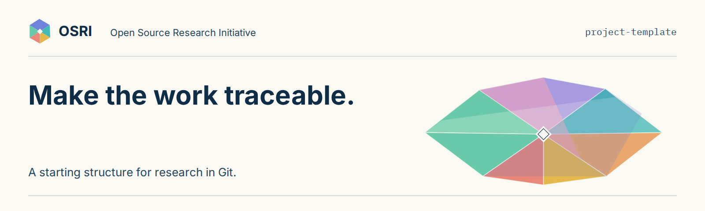

# [Project title]

English | [简体中文（待审核）](translations/zh-Hans/README.md)

Use this repository for one coherent research project. It can span several fields and produce several publications.

## Begin

1. Choose **Use this template** to create a repository. An administrator can create it under OSRI, or you can begin in your own account.
2. Fill in the short brief below and open one issue for the first task.
3. Follow the [OSRI research guide](https://github.com/Open-Source-Research-Initiative/osri/blob/main/START_HERE.md). Ask for help in [Q&A](https://github.com/Open-Source-Research-Initiative/.github/discussions/new?category=q-a).

The [browser setup guide](https://open-source-research-initiative.github.io/guides/docs/browser-setup/) explains template creation, README editing, and the first issue. You can also ask a maintainer to add your brief or source table. No terminal or agent installation is required.

After creating your project, replace the prompts and remove these setup steps. Replace or remove the template header; it names this repository. Keep the project's question and current work easy to find.

## Project brief

- **Question:** What do you want to understand or contribute?
- **Human lead:** Name or GitHub handle.
- **Area:** One or more [OSRI areas](https://github.com/Open-Source-Research-Initiative/osri/blob/main/areas/README.md).
- **Scope and state:** What is included, what has been done, and what is still uncertain?
- **First task:** Link the issue and say what help is useful.
- **Project ID:** Ask an administrator to assign one when the project enters the shared directory.

## Work as the project develops

- Use [protocol.md](protocol.md) to record the method. Mark exploration and planned tests accurately.
- Keep source identities and evidence notes in [sources.csv](sources.csv), or a documented equivalent.
- Record data origins and terms in [data/README.md](data/README.md). Add analysis or model files when needed.
- Use the [writing outline](writing/README.md) to develop a blog, preprint, conference paper, or journal article.
- Keep contribution credit and material agent assistance in [contributions.md](contributions.md).

Use the [help and review guide](https://open-source-research-initiative.github.io/guides/docs/find-help/) to find collaborators or request review. Discuss roles and authorship as the work develops.

The [task record](research-task.md) is optional. A small correction or source lead needs no full form.

## Shared rules

This starter uses [OSRI-0.1.0](https://github.com/Open-Source-Research-Initiative/osri/blob/8c39a0a36c0e962060659b1d51f666c367f9464a/governance/contribution-standards.md). Record any later adoption decision in this project.

You may use your own agent, selected skills, or manual methods. No paid tool bundle is required. A person checks evidence and authorizes acceptance and publication.

Follow the guides for [writing](https://github.com/Open-Source-Research-Initiative/osri/blob/main/governance/writing-style.md), [translation](https://github.com/Open-Source-Research-Initiative/osri/blob/main/governance/translation.md), and [visual identity](https://github.com/Open-Source-Research-Initiative/osri/blob/main/governance/visual-identity.md).

Original starter guides use CC BY 4.0; original starter code and configuration use MIT. See [licensing](LICENSE.md). Declare terms for added research materials before sharing them.
