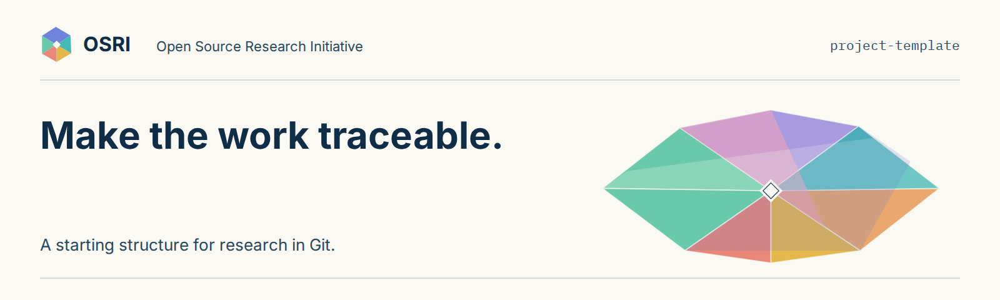

# [项目名称]

> **待审核译稿（draft）** · 译者：Codex · 人工审核：待定 · [英文参考原文](https://github.com/Open-Source-Research-Initiative/project-template/blob/1950bc5bf5f4104149282cc357309a5affb766a4/README.md)

[English](../../README.md)

[参与此项目](CONTRIBUTING.md)

此仓库用于一项完整连贯的研究项目。项目可以跨越多个领域，并产生多项发表成果。

## 开始

1. 选择 **Use this template** 创建仓库。管理员可以在 OSRI 下创建，你也可以从自己的账户开始。
2. 填写下方简要说明，为第一个任务新建一个 issue。
3. 遵循 [OSRI 研究入门指南（中文待审核译稿）](https://github.com/Open-Source-Research-Initiative/osri/blob/main/translations/zh-Hans/START_HERE.md)。需要帮助时，请使用[问答区（Q&A）](https://github.com/Open-Source-Research-Initiative/.github/discussions/new?category=q-a)。

[浏览器设置指南（中文待审核译稿）](https://open-source-research-initiative.github.io/zh-hans/guides/docs/browser-setup/)说明了如何从模板创建仓库、编辑 README 和创建第一个 issue。你也可以请维护者加入项目简要说明或资料表格。无须终端或安装智能体。

创建项目后，替换提示文字并删除这些设置步骤。替换或移除模板页头，其中写有本模板仓库的名称。让项目的问题和当前工作易于查找。

## 项目简要说明

- **问题：** 你想理解什么，或作出什么贡献？
- **人类负责人：** 姓名或 GitHub 用户名。
- **领域：** 一个或多个 [OSRI 领域（英文）](https://github.com/Open-Source-Research-Initiative/osri/blob/main/areas/README.md)。
- **范围与状态：** 包含什么、已完成什么，还有哪些不确定性？
- **第一个任务：** 关联 issue，并说明需要什么帮助。
- **项目 ID：** 项目加入共同目录时，请管理员分配。

## 随项目推进

- 用 [protocol.md（英文模板）](../../protocol.md)记录方法，准确区分探索和计划中的检验。
- 在 [sources.csv（英文表头）](../../sources.csv)或有说明的等效记录中保存资料标识与证据笔记。
- 在 [data/README.md（英文）](../../data/README.md)中记录数据来源与条款。按需添加分析或模型文件。
- 使用[写作提纲（英文）](../../writing/README.md)撰写博客、预印本、会议论文或期刊论文。
- 在 [contributions.md（英文）](../../contributions.md)中记录贡献署名和实质性的智能体辅助。

按照[协作与评审指南（中文待审核译稿）](https://open-source-research-initiative.github.io/zh-hans/guides/docs/find-help/)寻找协作者或申请评审。随着工作推进讨论角色与作者署名。

[任务记录（英文）](../../research-task.md)按需使用。小修正或资料线索无须填写完整表单。

## 共同规则

此模板采用 [OSRI-0.1.0（英文基准）](https://github.com/Open-Source-Research-Initiative/osri/blob/8c39a0a36c0e962060659b1d51f666c367f9464a/governance/contribution-standards.md)。后续采用其他版本时，在项目中记录决定。

你可以使用自己的智能体、选定技能或手工方法。无须付费工具套装。由人检查证据，并授权接受修改与公开成果。

遵循[写作](https://github.com/Open-Source-Research-Initiative/osri/blob/main/translations/zh-Hans/governance/writing-style.md)、[翻译](https://github.com/Open-Source-Research-Initiative/osri/blob/main/translations/zh-Hans/governance/translation.md)与[视觉识别](https://github.com/Open-Source-Research-Initiative/osri/blob/main/translations/zh-Hans/governance/visual-identity.md)指南；这些中文页面均为待审核译稿。

模板的原创指南采用 CC BY 4.0；原创代码与配置采用 MIT。详见[许可说明（英文）](../../LICENSE.md)。共享新增研究材料前，应声明适用条款。
